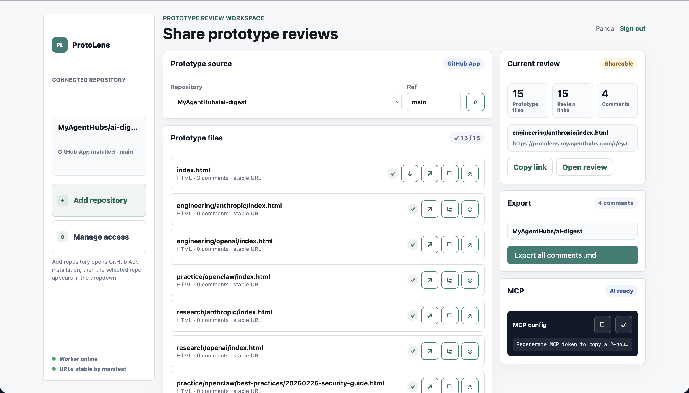
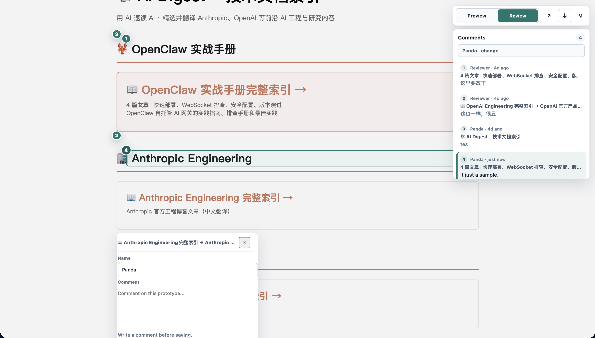

# ProtoLens

Review AI-generated HTML prototypes from GitHub.

ProtoLens turns static HTML, SVG, and PNG prototype files into stable review links. Teammates can open a link, click the prototype, leave anchored comments, export the feedback as Markdown, or let AI agents retrieve the review data through MCP.

[Open ProtoLens](https://protolens.myagenthubs.com) · [MCP endpoint](https://protolens.myagenthubs.com/mcp) · [Quickstart](docs/quickstart.md) · [Security](docs/security.md)



## Why ProtoLens

AI teams produce a lot of HTML prototypes, but review usually falls apart at the last mile: people push temporary repos, send zipped files, publish unsafe public pages, or paste feedback back into chat.

ProtoLens keeps the loop simple:

- Connect a GitHub repository through the ProtoLens GitHub App.
- Discover static prototype files such as `index.html`, `.svg`, and `.png`.
- Share a stable review link for each prototype.
- Collect comments anchored to the selected area or text.
- Export comments as Markdown or fetch them from an AI tool through MCP.



## How It Works

1. Install the ProtoLens GitHub App on selected repositories.
2. Open the ProtoLens dashboard and choose a repository.
3. ProtoLens discovers reviewable static prototype files.
4. Copy or open the stable review URL.
5. Reviewers comment directly on the prototype.
6. Owners export Markdown feedback or use the MCP server from AI tools.

ProtoLens is built for AI prototype collaboration: one-person companies, small product teams, internal tool teams, and agent workflows that need fast human review without setting up a full staging system.

## Security And Privacy

This public repository contains product-facing docs and screenshots only. The production implementation is not published here.

ProtoLens is designed around GitHub-backed ownership:

- Repository access is controlled by the user's GitHub App installation.
- Prototype files are fetched by repo, ref, and path instead of cloning and running arbitrary code.
- Review comments are stored as Markdown-oriented review data associated with the selected GitHub-backed prototype.
- HTML review rendering is sandboxed for static prototype review. JavaScript execution and form submission are intentionally constrained.
- Large files may be refused by current safety and resource limits.

See [Security](docs/security.md) for more detail.

## MCP For AI Agents

ProtoLens exposes an MCP server so AI tools can list prototype files, create review links, read comments, and export Markdown feedback.

```json
{
  "mcpServers": {
    "protolens": {
      "url": "https://protolens.myagenthubs.com/mcp"
    }
  }
}
```

Some clients also support short-lived bearer-token configuration generated from the ProtoLens dashboard. See [MCP](docs/mcp.md).

## Public Repo Scope

This repository is the public product home for ProtoLens. It intentionally does not contain:

- Worker source code
- Deployment configuration
- Secrets or environment setup
- Internal launch plans
- Private user or review data

Use this repo to understand the product, share examples, and link to public documentation.

## Links

- Product: https://protolens.myagenthubs.com
- MCP: https://protolens.myagenthubs.com/mcp
- GitHub App: https://github.com/apps/myagenthubs-protolens
- Contact: support@myagenthubs.com
